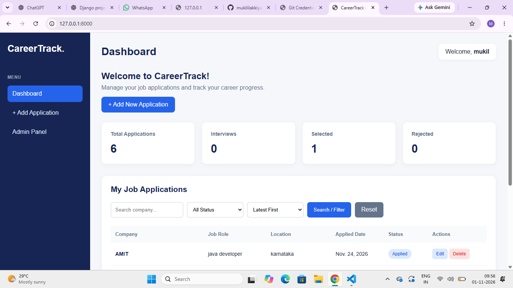

# CareerTrack | Job Application Management System

<p align="center">
  A Django-powered web application to manage, organize, and track job applications efficiently.
</p>

## Overview

**CareerTrack** is a full-stack web application built with Python and Django that helps job seekers manage their job search activities from a centralized dashboard.

Users can record job applications, monitor application progress, organize opportunities, and view application statistics. The application also supports individual user accounts, ensuring that each user manages their own application records.

This project demonstrates practical implementation of Django backend development, database management, authentication, CRUD operations, and frontend integration.

## Key Features

### Authentication and User Management
- User registration and login.
- Secure session-based authentication using Django.
- User-specific job application records.
- Protected application management pages.

### Job Application Management
- Create, view, update, and delete job applications.
- Track company, job role, location, application date, job link, and notes.
- Delete applications with confirmation.

### Search, Filter and Sorting
- Search applications by company name.
- Filter applications by status.
- Sort applications by application date.
- Sort company names alphabetically.

### Dashboard and Data Management
- Total applications overview.
- Interview, selected, and rejected application counts.
- Paginated job application listings.
- Responsive dashboard interface.

## Technology Stack

| Category | Technologies |
|---|---|
| Programming Language | Python |
| Backend Framework | Django |
| Frontend | HTML5, CSS3 |
| Database | SQLite |
| Database Access | Django ORM |
| Authentication | Django Authentication System |
| Development Environment | Visual Studio Code |
| Version Control | Git and GitHub |

## Application Architecture

CareerTrack follows Django's Model-View-Template (MVT) architecture.

- **Model:** Defines the job application database structure.
- **View:** Handles business logic, authentication, search, filtering, and application management.
- **Template:** Displays the dashboard and forms using HTML and CSS.
- **Database:** Stores user and job application information.

## Project Structure

```text
job_tracker_project/
│
├── jobapp/
│   ├── migrations/
│   ├── templates/
│   │   └── jobapp/
│   │       ├── home.html
│   │       ├── add_job.html
│   │       ├── edit_job.html
│   │       ├── delete_job.html
│   │       ├── login.html
│   │       └── register.html
│   ├── forms.py
│   ├── models.py
│   ├── urls.py
│   └── views.py
│
├── jobtracker/
│   ├── settings.py
│   ├── urls.py
│   ├── asgi.py
│   └── wsgi.py
│
├── screenshots/
│   └── dashboard.png
│
├── .gitignore
├── manage.py
├── requirements.txt
└── README.md
```

## Dashboard Screenshot



## Installation and Setup

1. Clone the repository:

```bash
git clone https://github.com/mukililakkiya/Career-Track-Job-Application-Tracker.git
```

2. Navigate to the project folder:

```bash
cd Career-Track-Job-Application-Tracker
```

3. Create and activate a virtual environment:

```bash
python -m venv venv
```

4. Install dependencies:

```bash
pip install -r requirements.txt
```

5. Configure your `.env` file with your own Django secret key and DEBUG setting.

6. Apply migrations:

```bash
python manage.py migrate
```

7. Start the development server:

```bash
python manage.py runserver
```

8. Open `http://127.0.0.1:8000/` in your browser.

## Skills Demonstrated

- Python programming
- Django web development
- Database design and ORM
- CRUD operations
- User authentication
- HTML and CSS
- Git and GitHub

## Future Enhancements

- Job application reminders.
- Export application reports.
- Advanced dashboard analytics.
- Cloud deployment.

## Author

**Mukil Ilakkiya**

[GitHub Repository](https://github.com/mukililakkiya/Career-Track-Job-Application-Tracker)
